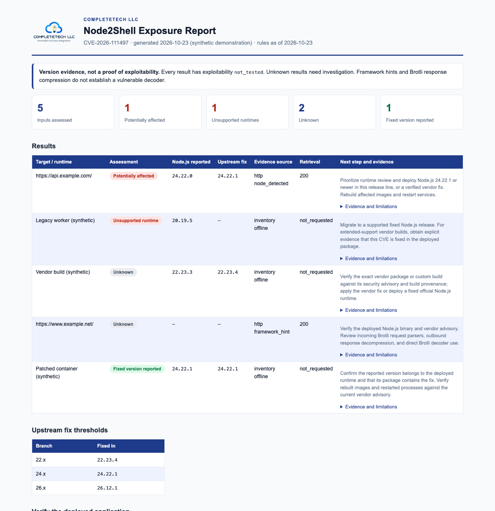

<p align="center">
  
</p>

<p align="center">
  <a href="https://github.com/CompleteTech-LLC/node2shell-check/actions/workflows/tests.yml"></a>
  
  
  <a href="LICENSING.md"></a>
</p>

<p align="center">
  <b>Find Node.js runtimes and websites reporting a version affected by Node2Shell</b><br>
  CVE-2026-111497 · offline runtime assessment · passive, single-file, dependency-free
</p>

---

`node2shell-check` compares the Node.js version a runtime or website reports with the official upstream fix for each supported branch. Assess a version you already know, collect metadata inside a deployed service, or inspect a website's ordinary public response. It sends **no exploit payloads**, never decodes Brotli, and reports uncertainty honestly: a hidden, vendor-built, or conflicting version is `unknown`, never "safe".

## Quick start

```sh
git clone https://github.com/CompleteTech-LLC/node2shell-check.git
cd node2shell-check

python node2shell_check.py --node-version 24.22.0                       # offline, no network calls
node collect-runtime.cjs > runtime.json                                 # run inside the deployed service
python node2shell_check.py --inventory runtime.json --format html --output report.html
python node2shell_check.py --input websites.txt --format html --output websites-report.html
```

Python 3.10+ on Windows, macOS, or Linux. Nothing to install. Node.js is needed only to run the optional collector.

## The report

`--format html` produces a single offline, script-free file with your logo, summary tiles, every result with its evidence and next step, and the upstream fix table. It follows the reader's light or dark theme and prints cleanly.

<p align="center">
  <picture>
    <source media="(prefers-color-scheme: dark)" srcset="docs/images/report-dark.png">
    
  </picture>
</p>

<p align="center"><sub>Synthetic example built from reserved <code>example.*</code> domains and invented runtimes. <a href="docs/example-report.html">View the HTML</a>.</sub></p>

Use `--logo path/to/logo.png` and `--brand "Your Company"` to brand it for your own organization. CSV and JSON remain available for spreadsheets and pipelines; `--fail-on-finding` exits 1 when a pipeline should stop.

## What the results mean

| Status | Meaning |
| --- | --- |
| 🔴 `potentially_affected` | A plain Node.js version below its branch's fix is reported. Verify the deployed build and prioritize remediation. |
| 🟠 `unsupported_runtime` | The version is on an older, unsupported upstream line. Verify vendor support and move to a supported, patched runtime. |
| 🟢 `fixed_version_reported` | The reported version meets the fix. Not independent verification of installed patches. |
| ⚪ `unknown` | Version missing, conflicting, qualified, custom-built, pre-release, or outside this rule snapshot. |

| Node.js branch | 22.x | 24.x | 26.x |
| --- | --- | --- | --- |
| **Fixed in** | 22.23.4 | 24.22.1 | 26.12.1 |

Thresholds come from the [Node.js October 2026 security releases](https://nodejs.org/en/blog/vulnerability/october-2026-security-releases) and the release notes for [22.23.4](https://nodejs.org/en/blog/release/v22.23.4), [24.22.1](https://nodejs.org/en/blog/release/v24.22.1), and [26.12.1](https://nodejs.org/en/blog/release/v26.12.1), released 2026-10-21. The embedded rule snapshot is dated **2026-10-23**.

> [!IMPORTANT]
> **Potential exposure is not confirmed exploitability.** Every result keeps exploitability `not_tested`. The vulnerability involves decoding attacker-controlled Brotli data, and a version alone cannot show whether an application reaches that code path. Treat every result as a prompt for an administrator to check.

## How it works

- **Known version:** `--node-version` (repeatable) compares a version you obtained elsewhere. No network calls.
- **Runtime inventory:** `collect-runtime.cjs` records version and build metadata from the Node.js binary that runs the service. It never loads application code, reads environment variables, decompresses data, or opens a connection, and it cannot attest vendor patch provenance.
- **Website metadata:** reads `robots.txt`, then makes ordinary `GET` requests with verified TLS, an honest User-Agent, bounded responses, and pacing. Redirects stay on the same host or its `www` counterpart. It fetches nothing else and sends no compressed bodies, credentials, or crafted requests.

Input modes can be combined in one report; each observation keeps its own evidence. Express or Next.js hints never become Node.js version evidence, and Brotli response compression does not prove request decoding.

Check only targets you are authorized to assess, and keep real target lists, inventories, and results out of version control.

## Documentation

- [Full reference](docs/REFERENCE.md): every CLI option, inventory field, output field, and request rule
- [Assessment methodology](docs/NODE2SHELL.md): how each version is classified, with sources
- [Contributing](CONTRIBUTING.md) · [Security policy](SECURITY.md)

```sh
python -m unittest -v      # local-only tests; no external websites are contacted
```

For agents contributing to this repository, [AGENTS.md](AGENTS.md) contains the shared development instructions; [CLAUDE.md](CLAUDE.md) points Claude to them.

## License

Dual licensed. It's free under [AGPL-3.0](LICENSE) for research, education, and open-source use. A commercial license is available for closed-source products and hosted services that don't publish their source; see [LICENSING.md](LICENSING.md) for details. The CompleteTech LLC name and logo are covered by neither license; see [BRAND_ASSETS.md](BRAND_ASSETS.md).

<p align="center">
  <a href="https://complete.tech"></a><br>
  <sub>Built by <a href="https://complete.tech">CompleteTech LLC</a> · Innovation at Every Integration</sub>
</p>
